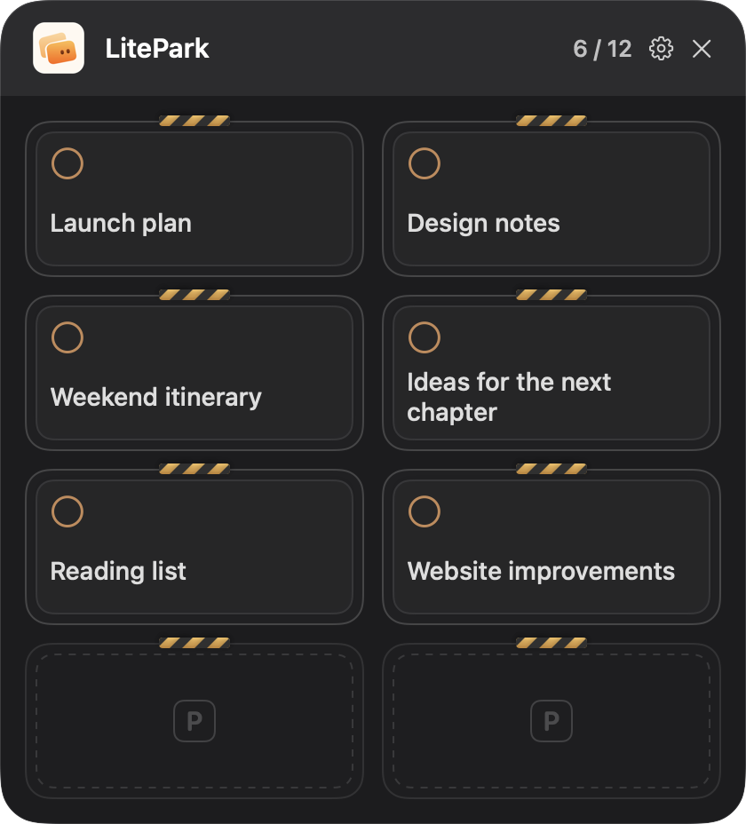

<p align="center">
  
</p>

<h1 align="center">LitePark</h1>

<p align="center"><strong>Park it now. Pick it up later.</strong></p>

<p align="center">A lightweight macOS companion for parking AI conversations you want to return to later.</p>

<p align="center">
  
</p>

## What is LitePark?

ChatGPT history is useful for finding old conversations, but it does not express a simple intention: “I cannot deal with this now, but I want to come back to it.” LitePark adds that small workflow to five Mac apps: ChatGPT, Doubao, Doubao Work, WorkBuddy and Qwen Work.

Use a global shortcut to park the conversation currently open in a supported app. A compact, two-column Parking Board gives each saved conversation its own space until you open it again or mark it done.

## Features

- Add the frontmost supported conversation with `⌃⌥L` or `⌃⌥⌘L`
- Open or close the Parking Board with `⌃⌥K`
- Reorder cards across rows and columns using the handle shown on hover
- Set Card Limit to 6, 9, 12, 16, or 20 cards; the default is 12
- Open a saved conversation in its original client or through its saved conversation link
- Mark a conversation done to remove it from the board
- Move the floating trigger anywhere on your displays
- Keep queue data locally on your Mac
- See a hover background and text hint on the appearance, settings and close controls

## Requirements

- macOS 13 or later
- At least one supported Mac client: ChatGPT, Doubao (豆包), Doubao Work (豆包工作), WorkBuddy or Qwen Work (千问办公)
- Accessibility permission for LitePark

LitePark uses macOS Accessibility to identify the foreground conversation. Depending on the client, it saves a title, a conversation URL or a native session link. WorkBuddy can resolve the visible title against its local session index.

## Installation

1. Download `LitePark-v1.2.2-macOS.zip` from the [v1.2.1 release](https://github.com/victor-zhang-2026/LitePark/releases/tag/v1.2.2).
2. Unzip it and move `LitePark.app` to Applications.
3. Right-click LitePark and choose **Open** the first time.
4. Grant Accessibility access when macOS asks. You can also enable it in **System Settings → Privacy & Security → Accessibility**.
5. Open a conversation in a supported client.

The public build is not notarized with Apple. macOS may show an unidentified developer warning. Use right-click → **Open**, or choose **Open Anyway** in **System Settings → Privacy & Security** after the first blocked launch.

## Usage

1. Open a conversation in a supported client.
2. Press `⌃⌥L` to add it to LitePark.
3. Hover over or click the floating LitePark trigger to show the board.
4. Click a conversation card to return to the conversation.
5. Hover a card to reveal its drag handle, or use the circle at the top left to mark it done.
6. Use **Settings → Card Limit** to adjust capacity. The header shows saved cards / capacity.

When the board is full, new additions are paused and a brief “Card limit reached.” message appears. Lowering the limit keeps all existing cards; adding resumes when the count falls below the limit. Empty spaces are visual placeholders.

## Known issues

### Conversation names

Title-based cards (including ChatGPT and Qwen Work) rely on a unique title. For the most reliable workflow:

1. Give the conversation a useful name in ChatGPT first.
2. Add it to LitePark.
3. Avoid renaming it in ChatGPT after adding it.

Different conversations with the same title are treated as ambiguous. This mechanism is planned for improvement in a future version, without a committed date.

### Sidebar visibility

Automatic reopening requires one exact matching conversation in ChatGPT Desktop's sidebar accessibility tree. If the whole sidebar is hidden, LitePark opens it once to find the conversation and then tries to restore the hidden state. LitePark can load additional sidebar rows and expand project groups to locate a match. LitePark keeps the item when it cannot safely identify one unique match.

## Privacy

LitePark stores only the metadata required for its local queue: a local item ID, provider, conversation title, reopening target, added time and manual order. It stores no prompts, responses, account data, screenshots, analytics, or telemetry. Nothing is uploaded by LitePark.

All screenshots in this repository use fictional demo conversation names.

## Build from source

```bash
./scripts/build-app.sh
```

The build script creates `.build/LitePark.app`. It uses the stable LitePark local signing identity when available and otherwise falls back to ad-hoc signing. Public distribution requires an appropriate Apple Developer signing and notarization setup for a warning-free first launch.

For a specific installed macOS SDK, set `LITEPARK_MACOS_SDK` when building or packaging:

```bash
LITEPARK_MACOS_SDK=/Library/Developer/CommandLineTools/SDKs/MacOSX26.5.sdk ./scripts/build-app.sh
```

`./scripts/package-release.sh` creates a ZIP in `dist/` using the built app’s version. The focused, temporary-data checks can be run with `./scripts/test-parking-board.sh` and the same SDK override.

## Architecture

- SwiftUI Parking Board with AppKit floating panels
- AXUIElement integration for ChatGPT title capture and sidebar navigation
- Carbon global shortcuts
- Codable JSON persistence in Application Support

## Feedback

Try LitePark, [report an issue](https://github.com/victor-zhang-2026/LitePark/issues), share what works or fails in your workflow, and star the repository if you find it useful.

## Acknowledgements

The floating window interaction follows implementation lessons from [LiteTick](https://github.com/victor-zhang-2026/LiteTick). Its MIT notice is preserved in [`Acknowledgements/LiteTick-LICENSE.txt`](Acknowledgements/LiteTick-LICENSE.txt).

## License

[MIT](LICENSE)
